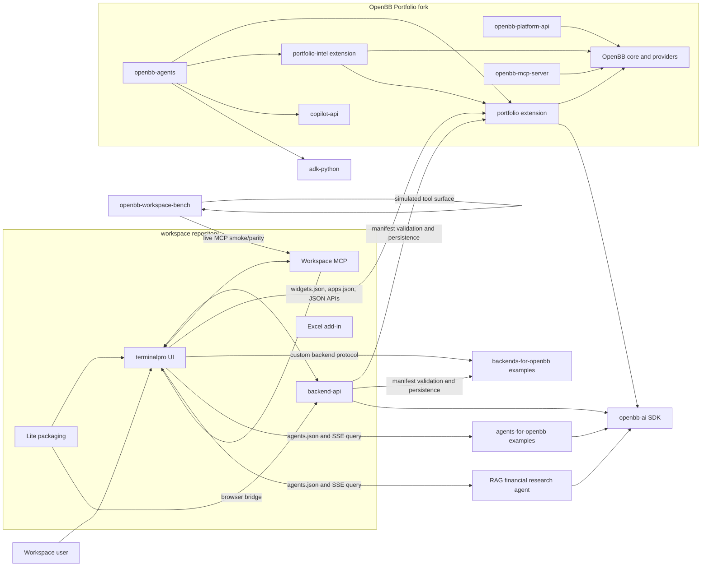

# Dependency architecture

## System graph



Arrows indicate use or invocation, not repository ownership. A protocol arrow
does not imply that the target repository should be installed as a package.

## Dependency types

### 1. Build and source dependencies

These relationships require source or a package at build/install time:

- `OpenBB` top-level package -> OpenBB core, providers, and extensions.
- `openbb-portfolio-intel` -> sibling `openbb-backtest` and
  `openbb-techtrade`.
- `openbb-agents` -> forked Google ADK source in `third_party/adk-python`.
- `openbb-techtrade` -> `pandas-ta-classic` nested submodule.
- Workspace backend -> published `openbb-ai`, FastMCP, database, cache, and
  cloud SDK packages.
- example agents and the RAG agent -> published `openbb-ai`.

Only direct source dependencies belong in an editable-install sequence.
Reference repositories should not be added to `PYTHONPATH`.

### 2. Runtime service dependencies

These relationships exist across process or network boundaries:

- Workspace frontend/backend -> configured custom backend URLs.
- Workspace -> configured custom agent URLs.
- Workspace MCP -> active Workspace browser session through its bridge.
- Portfolio custom copilot and local agents -> OpenAI-compatible model proxy.
- Portfolio routes -> MySQL and OpenBB provider APIs.
- Workspace backend -> database, Redis/RQ, object storage, and external hosted
  services depending on deployment mode.

### 3. Contract and test dependencies

These repositories need compatible schemas but do not import each other:

- `backends-for-openbb` and Portfolio backend share the Workspace custom
  backend contract.
- `agents-for-openbb`, the RAG agent, and Portfolio copilot share the
  `openbb-ai` agent contract.
- Workspace Bench models the Workspace MCP tool surface and Workspace state.
- Portfolio documentation and setup scripts use the examples and benchmark as
  pinned reference/test inputs.

### 4. Documentation and research dependencies

`openbb-docs`, `awesome-quant`, `openfigi-api`, and the example repositories
are pinned so design and implementation decisions can refer to a reproducible
revision. They are not automatically part of the production runtime.

## Protocol contracts

### Custom backend contract

**Producer repositories:** `backends-for-openbb`, `OpenBB` Portfolio and
Portfolio Intelligence extensions.

**Consumer repository:** `workspace`.

Minimum contract:

1. `widgets.json` describes widget identifiers, endpoints, parameters, and
   rendering behavior.
2. `apps.json` describes app layouts, prompts, and optional MCP servers.
3. Data endpoints return JSON in the shape described by each widget.
4. Browser-accessible deployments configure CORS and authentication.

Workspace's backend marketplace validates both manifests; Workspace's frontend
loads them and calls the configured endpoints. The Portfolio fork uses
`openbb-api --app` to merge extension manifests into one service.

### Custom agent contract

**Producer repositories:** `agents-for-openbb`,
`openbb-rag-financial-research-agent`, and the Portfolio custom copilot.

**Consumers:** Workspace UI/backend.

Typical contract:

1. `GET /agents.json` advertises agents, features, and the query endpoint.
2. `POST /v1/query` or the advertised equivalent accepts an
   `openbb-ai` `QueryRequest`.
3. The response is an SSE stream of OpenBB AI SDK event models.
4. Optional request content includes selected widgets, dashboard context, MCP
   tools, documents, and feature-specific metadata.

The published `openbb-ai` version is the compatibility anchor. Local source
co-location does not replace versioned contract testing.

### OpenBB Platform MCP contract

`openbb-mcp-server` converts OpenBB Platform/FastAPI routes into MCP tools and
resources. Its responsibility is financial-data and Platform API access. It
depends on `openbb-core` and FastMCP.

### Workspace MCP contract

Workspace MCP manipulates Workspace state: dashboards, layouts, apps, widgets,
prompts, resources, and related browser-visible artifacts. The Workspace
backend owns integrated routes and a standalone `workspace_mcp` package. A
browser bridge connects MCP commands to Workspace UI state.

These MCP servers are complementary:

| Plane | Primary object model | Owning source |
| --- | --- | --- |
| OpenBB Platform MCP | financial data routes and Platform APIs | `OpenBB/openbb_platform/extensions/mcp_server` |
| Workspace MCP | dashboards, apps, widgets, layouts, Workspace state | `workspace/backend-api/backend/workspace_mcp` |
| OpenBB Agents MCP | portfolio-specific agent tools | `OpenBB/openbb_platform/extensions/agents` |

Naming all three simply "OpenBB MCP" obscures ownership and causes incorrect
setup instructions.

## Data flows

### Portfolio data in Workspace

```text
Provider API / MySQL
        |
        v
OpenBB Platform + Portfolio extension
        |
        +-- /api/v1/*, /portfolio/*, /stock/*, /espp/*
        +-- /widgets.json
        +-- /apps.json
        +-- /agents.json and query stream (optional copilot)
        |
        v
Workspace backend registration and frontend rendering
```

The Portfolio extension calls OpenBB Python APIs in-process. Workspace treats
the resulting service exactly like any other custom backend.

### RAG agent query

```text
Workspace query + selected widget metadata
        |
        v
RAG agent (openbb-ai QueryRequest)
        +--> Workspace widget-data callback
        +--> ChromaDB retrieval
        +--> SEC/PDF/transcript corpus
        +--> OpenAI-compatible LLM and embeddings
        |
        v
SSE reasoning, answer, and citation events
```

The RAG agent does not import OpenBB Platform locally. Its OpenBB relationship
is the Workspace agent protocol and widget-data callback supplied by
`openbb-ai`.

### Benchmark execution

```text
Task JSON
   |
   +--> deterministic Workspace simulator --> grader
   |
   +--> live Workspace MCP --> browser bridge --> Workspace --> grader/parity diff
   |
   +--> Harbor bundle --> archived standalone workspace-mcp sidecar --> grader
```

Only the second and third paths exercise real MCP transport. Only a live
browser-backed run exercises actual Workspace state.

## Compatibility risks

| Risk | Evidence | Consequence | Control |
| --- | --- | --- | --- |
| `openbb-ai` version skew | Agent examples `^2.0.1`, RAG `^1.7.5`, Workspace backend `^2.1.0` | Agent descriptor or SSE model drift | Run contract tests against every supported agent generation |
| Workspace source/runtime gap | Source is pinned, but full self-host build is not validated | A source audit can be mistaken for deployability | Keep source, build, and live validation gates separate |
| Benchmark sidecar layout mismatch | Harbor expects root `workspace_mcp/`; Workspace source nests it | `third_party/workspace` cannot directly satisfy exporter validation | Pin the actual sidecar repo or add a deliberate adapter upstream |
| Duplicate standalone clones | Same repository exists in `OpenBBAll` and as a gitlink | Changes can be made in one copy but not reflected in the pin | Use explicit drift commands and update gitlinks by commit |
| Git submodules track commits, not branches | `.gitmodules` records `main`, but the superproject pins a SHA | Developers may assume `git pull` updates dependencies | Use `git submodule update --remote` only in intentional pin-update work |
| MCP naming ambiguity | Three MCP surfaces exist | Wrong server or PyPI package may be installed | Always qualify Platform MCP, Workspace MCP, or Agents MCP |
| Generated/hosted dependencies | Workspace excludes some hosted assets/services | Partial source may not reproduce hosted product | Document deployment boundaries and test the intended mode |

