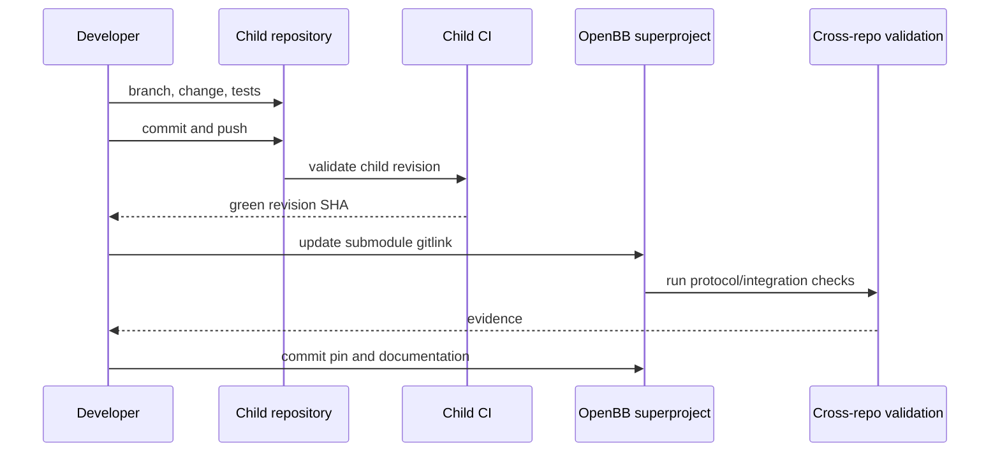

# Cross-repository development workflows

## 1. Clone and select a profile

The Portfolio repository is the dependency control plane:

```powershell
git clone https://github.com/prajoria/OpenBB.git
Set-Location OpenBB
git submodule sync --recursive
```

Do not immediately use `--recurse-submodules` unless all reference
repositories are required. Choose an initialization profile from
[Submodule consolidation](submodule-consolidation.md#initialization-profiles).

After initialization:

```powershell
git submodule status --recursive
git status --short
```

Interpret submodule status prefixes:

- space: checked out at the recorded commit;
- `-`: registered but not initialized;
- `+`: checkout differs from the recorded commit;
- `U`: merge conflict.

## 2. Choose the integration surface

| Goal | Primary repositories | Contract to test |
| --- | --- | --- |
| Add an OpenBB data command/provider | `OpenBB` | Python extension/provider interfaces |
| Add Portfolio widgets or apps | `OpenBB`; optionally `workspace` | `widgets.json`, `apps.json`, JSON endpoints |
| Add a custom Workspace backend example | `backends-for-openbb`; optionally `workspace` | Backend manifests, CORS, auth, endpoint schemas |
| Add a custom agent example | `agents-for-openbb`; optionally `workspace` | `agents.json`, query request, SSE events |
| Add RAG research behavior | RAG agent; optionally `workspace` | Agent contract, widget-data callback, citations |
| Change Workspace UI/backend | `workspace` | Frontend/backend APIs, manifest parsing, Workspace MCP |
| Change Workspace MCP behavior | `workspace` and `openbb-workspace-bench` | Tool schemas, browser bridge, simulator/live parity |
| Change OpenBB Platform MCP behavior | `OpenBB` | Platform route-to-MCP mapping |
| Change local portfolio agents | `OpenBB` and `adk-python` when necessary | MCP/REST tools, guardrails, portfolio data contracts |

## 3. Backend or widget change

1. Implement the data route and schema in `OpenBB` or
   `backends-for-openbb`.
2. Update `widgets.json`; update `apps.json` when layout, prompts, or MCP
   declarations change.
3. Validate the manifest and direct endpoint without Workspace.
4. Register the backend in Workspace and verify rendering, parameters,
   authentication, and errors.
5. Add or update deterministic Workspace Bench fixtures only when the
   benchmark is intended to model the new behavior.
6. If an example repository changed, commit/push it first and then update the
   Portfolio submodule pin.

Do not use a benchmark simulator result as the only evidence for a UI contract.

## 4. Agent change

1. Select the supported `openbb-ai` contract version.
2. Validate `GET /agents.json`.
3. Send a representative `QueryRequest` to the advertised query endpoint.
4. Parse the full SSE stream and verify terminal/error events, not only HTTP
   status.
5. Test optional features actually advertised by the descriptor: widgets,
   citations, charts, tables, documents, MCP tools, dashboard context, or
   feedback.
6. Connect the endpoint to Workspace and run one real query.
7. For RAG changes, separately test ingestion, retrieval, model generation,
   and Workspace streaming so a failure can be assigned to the correct layer.

When changing Workspace's agent consumer, test both:

- an `openbb-ai` 2.x example agent;
- the RAG agent's `openbb-ai` 1.x descriptor/stream, or explicitly declare and
  document that compatibility has ended.

## 5. Workspace MCP change

1. Change the Workspace-owned implementation in the `workspace` repository.
2. Run its unit and schema tests.
3. Update the benchmark simulator only when the real surface intentionally
   changed.
4. Run the benchmark's deterministic tests and schema audits.
5. Run live MCP smoke against the changed sidecar/integrated endpoint.
6. When a browser is available, run live parity for a representative task.
7. Update the `third_party/workspace` and
   `third_party/openbb-workspace-bench` pins only after both repositories have
   committed, reachable revisions.

Do not install the unrelated PyPI package named `workspace-mcp`; the existing
Workspace runbook identifies it as Google Workspace software.

## 6. OpenBB Platform MCP change

1. Change `openbb_platform/extensions/mcp_server`.
2. Validate Platform route discovery and route-to-tool/resource mapping.
3. Test against the intended OpenBB Platform application.
4. If a Workspace agent calls these MCP tools, test that agent separately.
5. Do not update Workspace Bench unless its Workspace-state tool surface also
   changed.

Platform MCP changes and Workspace MCP changes are independent unless a
specific agent workflow bridges both.

## 7. Local Portfolio-in-Workspace stack

The intended local data flow is:

1. start the OpenBB Platform/Portfolio backend;
2. expose merged Platform, Portfolio, widget, app, and optional agent routes;
3. start Workspace or use the approved hosted integration target;
4. register the Portfolio backend URL;
5. optionally start the model proxy for Portfolio Copilot;
6. optionally run Workspace Bench against the Workspace MCP surface.

Use the repository's existing setup and launch scripts rather than reconstructing
commands from this architecture report. The detailed operational source of
truth remains `docs/operations/workspace-local-development.md`.

## 8. Child-repository contribution and pin update



Never update a gitlink to an unpushed child commit. Other clones cannot
materialize it.

## 9. Compatibility test matrix

| Producer | Consumer | Minimum evidence |
| --- | --- | --- |
| Portfolio/backend example | Workspace | valid manifests, endpoint response, UI render |
| Example agent | Workspace | descriptor, request parsing, complete SSE stream |
| RAG agent | Workspace | descriptor, widget-data flow, retrieval citation stream |
| OpenBB Platform MCP | MCP client/agent | tool discovery, representative call, error mapping |
| Workspace MCP | Workspace Bench | schema audit, deterministic suite, live smoke |
| Workspace source | Portfolio backend | backend registration and representative widget/app |
| `adk-python` | `openbb-agents` | import, agent construction, MCP/REST test |
| `pandas-ta-classic` | TechTrade | indicator import and representative calculation |

## 10. Release sequencing

For a cross-repository release:

1. release or merge provider/source repositories first;
2. record immutable child SHAs;
3. update published package constraints where package-index dependencies are
   involved;
4. update Portfolio gitlinks;
5. run the compatibility matrix;
6. document intentional incompatibilities and migration steps;
7. merge the Portfolio pin update last.

For protocol-only integrations, semantic compatibility matters more than
simultaneous version numbers. For direct source dependencies, the gitlink is
the exact compatibility statement.

## 11. Recurring maintenance

### Weekly or before integration work

```powershell
git submodule status --recursive
git submodule foreach --recursive 'git status --short'
git diff --submodule=log
```

### Before changing pins

```powershell
git submodule sync --recursive
git fetch --recurse-submodules=no
git -C third_party\workspace fetch origin
git -C third_party\openbb-workspace-bench fetch origin
```

Fetch does not modify pins. Avoid bulk `git submodule update --remote` because
it combines unrelated upgrades without compatibility evidence.

### Before committing a superproject change

```powershell
git diff --check
git diff --submodule=log -- .gitmodules third_party
git status --short
```

Review unrelated working-tree changes separately. A gitlink update should
identify the child commit and the cross-repository validation performed.

## 12. Recommended follow-up work

### Priority 1: agent contract matrix

Add a small consumer-driven contract suite that runs Workspace's agent parser
against fixtures generated by both `openbb-ai` 1.x and 2.x agents. This is the
highest-value control for the observed version skew.

### Priority 2: resolve Workspace MCP repository identity

Document the canonical remote and ownership of the standalone repository
expected by Workspace Bench's Harbor exporter. Then choose one of:

- pin that repository as a separate submodule;
- change the exporter to archive the nested package from `workspace`;
- make the standalone repository a generated/released artifact with explicit
  provenance.

Do not add a guessed submodule.

### Priority 3: automated drift report

Add a read-only script that compares known standalone clones, initialized
submodules, and superproject gitlinks and emits:

- current SHAs;
- dirty state;
- ahead/behind state relative to configured branches;
- missing initialization;
- unreachable gitlink commits.

The script should report drift, not automatically update dependencies.

### Priority 4: manifest conformance fixtures

Share versioned JSON Schema or consumer-driven fixtures for `widgets.json`,
`apps.json`, and `agents.json` among Workspace, Portfolio, example
repositories, and Workspace Bench. Avoid copying implementation code across
repositories.

### Priority 5: submodule ownership metadata

Add a compact owners/purpose table near `.gitmodules` or in repository
contributor documentation so developers know which gitlinks are runtime,
source, tests, docs, or research references before initializing or updating
them.

